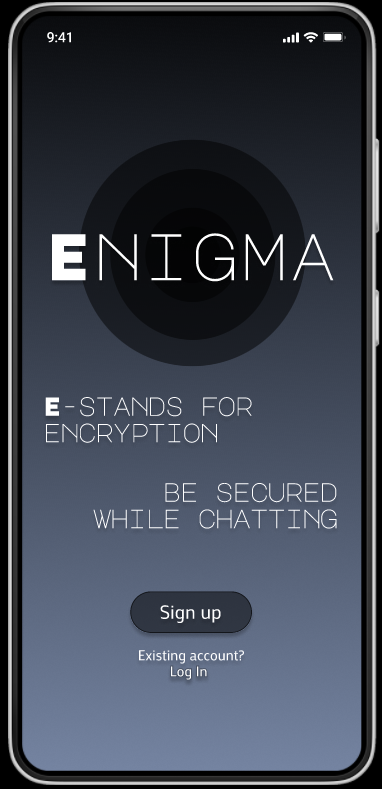
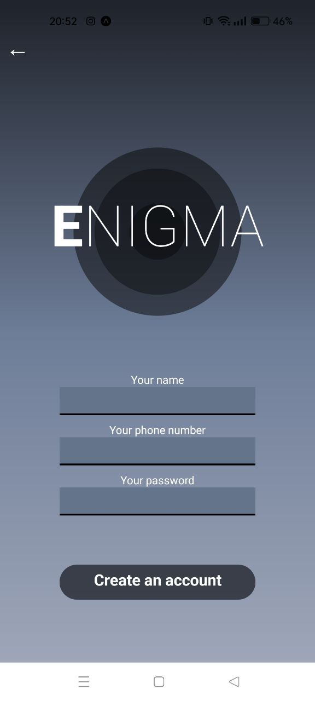
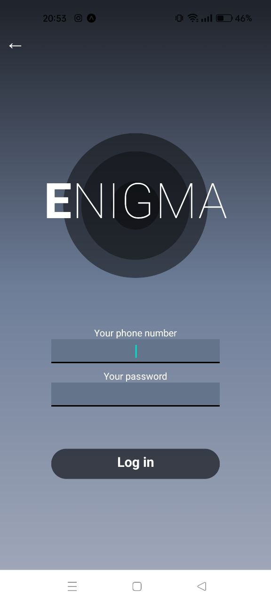
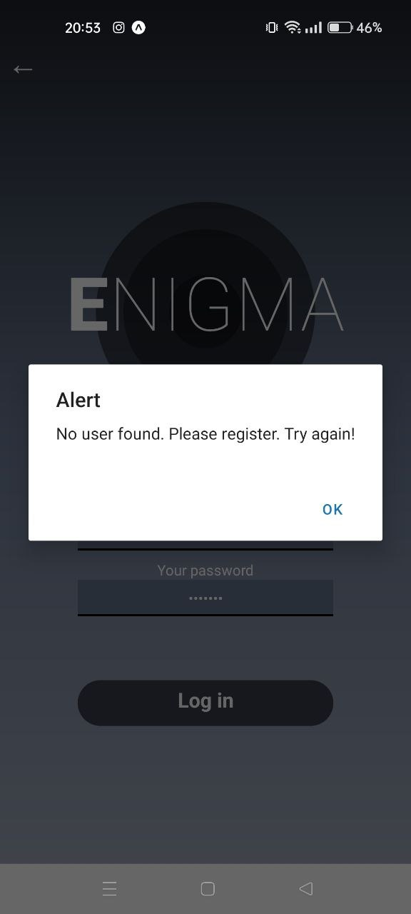
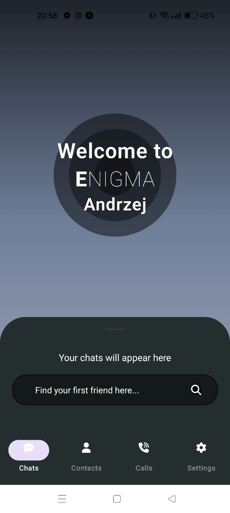
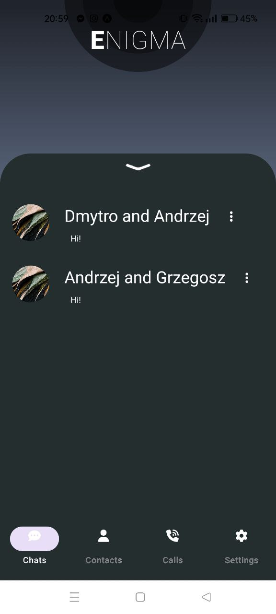
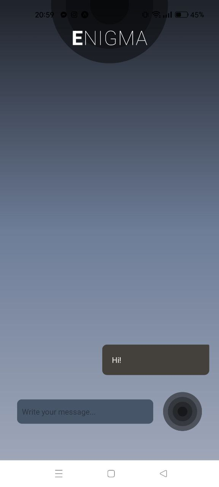
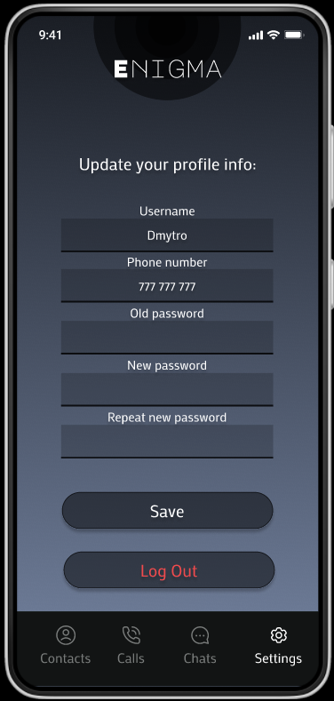
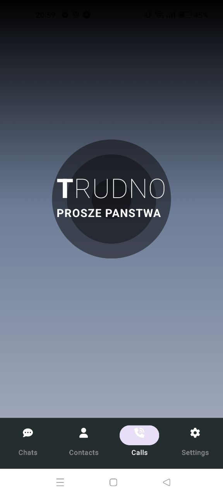

# ⚫️ Enigma is a new chat for you and your friends 👩‍💻👨‍💻  ⚫️ Enigma is an university OOP project 🎓   ⚫️ New secured chat 🚓

## Description
📖 The Oxford Dictionary defines "enigma" as something that is mysterious or difficult to understand. This notion inspired us to develop a revolutionary chat application, fortified with impenetrable encryption, allowing you to engage in conversations with absolute confidence in the security of your personal data.
  
👾 Our chosen symbol, the ⚫️black hole⚫️, encapsulates the essence of mystery and the unknown, symbolizing the protection of information from potential hackers. With this application, your data remains as secure and unassailable for possible hackers as the enigmatic depths of a black hole.
  
👀 Our dedicated team is committed to continuous improvement, infusing our application with sophistication and innovation. We have exciting plans to introduce additional features that will elevate your user experience and make our app an indispensable tool for secure communication. Stay tuned for these upcoming enhancements and unveil the true potential of EnigmaChat.

## Enigma UI design screenshots
Main page:
 

 If you don't have Enigma account - sign up! 🪪 

  Oh! You are already our user? 🖤🖤🖤  

  We don't have you in our data base! Please Sign up! 🔒  

  Find your friends and start first chat with them!📲 

  Swipe up, if you already have chats. 📖 

  Choose any chat you want, and start messaging! ⌨️ 

  Did you change your phone number? Or do you want to change old password? Or you changed your name? Go to the settings and change that! 🖤🖤🖤  

  We will add some new features! Be in touch with us! 🖤🖤🖤  

## Front-End
React Native

## Styles
TailwindCSS

## API
Java using SpringBoot

## Database
Firebase by google

## Authors
⚫️ Designed by [DieMon-dev](https://github.com/DieMon-dev)  
⚫️ Front-end by [KytryshAndrii](https://github.com/KytryshAndrii)  
⚫️ API by [DieMon-dev](https://github.com/DieMon-dev)  
⚫️ Database organised by [SmittD](https://github.com/SmittD)  
